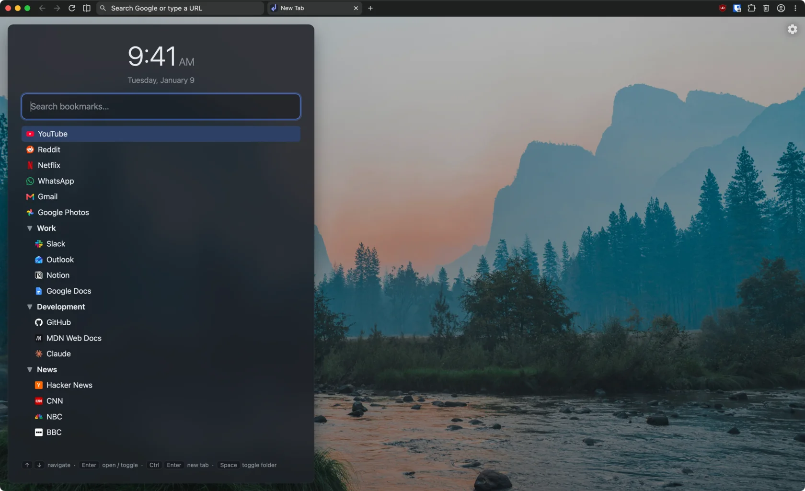

# kMarkTab

A keyboard-first new tab page extension for Chrome with searchable bookmarks, a clock, and custom backgrounds.



## Features

- **Bookmark search**: Start typing to get fuzzy, relevance-ranked bookmarks by title and URL.
- **Keyboard-first**: The search field is always focused. Use ↑/↓ and Page Up/Page Down to move, ←/→ or Space to collapse and expand folders, Enter to open a bookmark, and Ctrl+Enter (⌘+Enter on macOS) to open it in a new tab.
- **Backgrounds**: Rotating Unsplash photos from a curated set or your own collection, changed with every new tab, hourly, or daily; the Bing image of the day; an image URL; a local file; or a solid color.
- **Clock**: Time and date in 24- or 12-hour format.
- **Appearance**: Adjustable panel opacity and background blur.
- **Favicons**: From the browser's cache, Google, or DuckDuckGo.

## Privacy

kMarkTab has no analytics, tracking, or accounts. Your bookmarks, settings, and background file stay in the browser.

Network requests depend on your settings:

- **Unsplash background** (the default): Photos are fetched from the [kMarkTab backend](https://github.com/itsTPM/kMarkTab-backend/) and then loaded from Unsplash's image servers. Requests for photos from your own collection include the collection ID and a random install ID that the extension generates once. The backend keeps the IDs and your IP address in memory only to rate-limit requests, forgets them within a day, and doesn't log them.
- **Bing background**: The image of the day is fetched from `www.bing.com` using the selected market (e.g., `en-US`). The extension asks for access to `www.bing.com` only when you pick this background.
- **Image URL background**: The image is loaded from the address you entered.
- **Favicons**: With the Chrome provider (the default), icons come from the browser's own cache without additional network requests. If you chose another provider (Google or DuckDuckGo) in settings, it gets the hostname of each bookmark shown (e.g., `github.com`, not the full URL).
- **Web search**: Pressing Enter when no bookmark matches sends the query to your browser's default search engine, as the address bar would.

## Development

Requires Node 24 and pnpm 12. With [mise](https://mise.jdx.dev/), `mise install` sets up both — versions are pinned in `mise.toml` and `mise.lock`.

Install dependencies (this will also run the wxt and simple-git-hooks scripts):

```bash
pnpm install
```

Dev mode (launches a browser with the extension loaded and HMR):

```bash
pnpm dev          # Chrome
pnpm dev:firefox  # Firefox
```

Dev mode shows a mock bookmark tree. To use the browser's real bookmarks instead:

```bash
pnpm dev:real          # Chrome
pnpm dev:firefox:real  # Firefox
```

Build an extension:

```bash
pnpm build          # → .output/chrome-mv3
pnpm build:firefox  # → .output/firefox-mv2
pnpm zip            # store-ready archive (zip:firefox for Firefox)
```

The built extension can be loaded manually: `chrome://extensions` → "Developer mode" → "Load unpacked" → the `.output/chrome-mv3` directory.

### Backend

Unsplash photos come from [kMarkTab-backend](https://github.com/itsTPM/kMarkTab-backend/), so the extension needs no Unsplash key. Its URL is `WXT_BACKEND_URL` in `.env`; to use another one (e.g. a local backend), put it in `.env.local`:

```bash
WXT_BACKEND_URL=http://localhost:3000
```

### Checks

```bash
pnpm check  # typecheck + lint + format:check + test
pnpm fix    # lint:fix + format — auto-fix what can be fixed
```

Usually, you won't need to run `pnpm check` because it runs as a pre-commit hook ([simple-git-hooks](https://github.com/toplenboren/simple-git-hooks), installed by `pnpm install`). If it fails, run `pnpm fix`, restage, and commit again; `git commit --no-verify` skips it. After changing the hook config in `package.json`, run `pnpm install` to rebuild it.

The individual steps can also be run on their own:

**Tests**

```bash
pnpm test        # single run
pnpm test:watch  # watch mode
```

**Linting and formatting ([Oxlint](https://oxc.rs/docs/guide/usage/linter.html), [html-validate](https://html-validate.org/), [Stylelint](https://stylelint.io/), [Oxfmt](https://oxc.rs/docs/guide/usage/formatter.html))**

```bash
pnpm lint
pnpm lint:fix
pnpm format
pnpm format:check
pnpm typecheck
```
